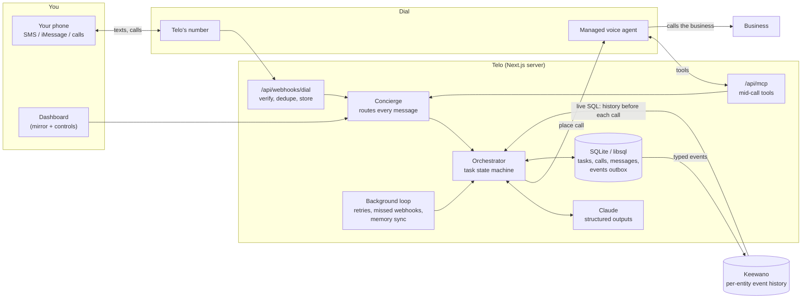

# Telo

**The AI that works the phones for small rental property managers.**

A property manager gives Telo one phone number. Tenants call or text it (photos welcome): *"The AC is out again, it's 85 in here."* Telo triages the report, calls two vendors at once to compare availability, price and terms, and gets the owner's OK by text while a vendor holds when the price is over the owner's limit. Then it books the tenant's window with the entry notice the law requires, checks "on the way?" and "fixed?" during the visit, and closes the job. Every unit and vendor's history lives in Keewano, and that memory changes what Telo does: who gets called first, and when to ask for a replacement price instead of another repair.

Built for small firms and owner-operators running about 20 to 500 long-term rentals without a maintenance coordinator. The seeded portfolio (one firm, two owners, three properties, eight units, eight vendors) stands in for property-management software, so the demo runs without any.

Built for SpeedHacks (SF Tech Week) on **[Dial](https://getdial.ai)** (phone numbers, AI calls, texts), **[Keewano](https://keewano.com)** (event memory) and **Claude** (reasoning). The brief and research are in [docs/property-management/](docs/property-management/).

---

## How it works for each party

- **Tenants** call or text Telo's number. Telo asks what's wrong (and for photos), gives safety instructions first for gas, smoke, CO or flooding, and texts back the vendor's window with the entry notice. It asks "fixed? Reply Y or N" at the visit.
- **Vendors** get called two at a time, ranked by their record across the portfolio (no-shows, late arrivals, first-visit fixes). Every call opens with "an AI assistant calling for the manager; this call is recorded". The one Telo doesn't book gets a polite no.
- **Owners** get a text only when a price is over their approval limit, while the vendor holds: *"Approve $650 tonight? It's the third failure since June. Want a replacement quote too?"* Their reply goes back on the same call.
- **The property manager** supervises by text and call: one text per new work order and one per booking, never a question Telo can answer itself. Ask anytime: *"which vendor no-shows most?"* or *"what does a water-heater replacement usually cost us?"* Telo answers from Keewano with live SQL.
- **The dashboard** (http://localhost:3210) is the manager's board, built to stay calm with many jobs at once: the numbers at a glance (open work orders, on the phone now, waiting on someone, visits booked, manager touches per job before Telo and with it), every live call side by side with the owner's question inline, a board by stage (new and calling, waiting on someone, booked, follow-up), and a flowchart on each work order's page.

## Architecture



**One task, start to finish:**

1. A text arrives (Dial webhook). The signature is verified, the event is stored under Dial's event id (so a redelivery is a no-op), and processing happens after the 200.
2. The **concierge** asks Claude to route the message: a new task, an answer to an open question, a decision, a status question, a cancel, a preference.
3. The **orchestrator** drives the task through explicit states: `new → needs_info → planning → ready → calling → reviewing → needs_approval | scheduled → … → completed | failed | cancelled`. Every transition is a compare-and-swap on `(status, version)`, so racing webhooks can't double-dial.
4. **Planning** runs a live **Keewano** query for the history between you and that business, has Claude turn it into a short brief, and writes the call plan: objective, what may be disclosed, what Telo can decide alone, what needs you, what to collect.
5. The call brief is rendered with fixed guardrails: it identifies itself as an AI calling for you, never shares passwords, PINs or card numbers, never claims what it doesn't know, and defers anything outside its authority with "I'll confirm with Dylan and call back". It is then placed with Dial (`makeCall`, idempotency key = Telo's call id).
6. When Dial reports `call.transcribed`, Claude reads the transcript into structured outcomes: offers, promises, confirmation numbers, rep name, quotes, promises from earlier calls now found kept or broken, and whether a decision is needed.
7. Claude decides the next step: complete, ask you (a decision, or a detail the business needs), call the next business, call back now, retry later, or **schedule** a call for when the business said ("call back in 3 days", "we open Monday at 9", "we'll call you back"). Scheduled calls wake on their own (inside 8 AM–9 PM), a business calling Telo's line back is matched to its task, and every task has a call cap. You get one concise text.
8. Everything that happened is recorded as an event. Typed events (categories, cents, seconds; never names or transcripts) are mirrored to Keewano on four streams: you × business (the main memory), the business, the task, and you.

**A maintenance work order** (`src/server/maintenance.ts`) runs on the same engine:

1. A tenant's text (or the transcript of their call) from a number in the portfolio creates a task with its unit, tenancy, owner and photos.
2. **Triage:** Claude reads the report into a trade, a severity and a job code. Gas, fire or CO: safety instructions to the tenant, a page to the manager, and no vendor call.
3. **Memory decides** (`src/server/portfolio/insights.ts`): live Keewano SQL ranks the approved vendors for the trade, and the asset's repair history says whether to ask for a replacement price too. The task page shows both queries.
4. The top two vendors are **called at once**. Over the owner's limit, the voice agent's `ask_customer` goes to the owner by text while the vendor holds.
5. **Booked:** the tenant gets the window and the entry notice (asking for consent under 24 hours), the other vendor a polite no, and the owner and manager one update each.
6. **Follow-up:** thirty minutes into the window, "on the way?" to the vendor and "fixed?" to the tenant. "Y" marks the vendor's promise kept and closes the work order with the count of manager touches.

Each step is a typed event on the Keewano streams of the unit, the vendor, the owner, the property, the tenancy, the asset and the firm (research.md section 5.3).

**Email and calendar (Google):** Telo reads your inbox, read-only. A receipt or confirmation from a business is saved to memory. One that answers what Telo was waiting on finishes the task without the call. One that needs a call ("your bill went up, call us") becomes a suggestion Telo makes only after you say yes. With your calendar connected, Telo books inside your free time instead of asking when works, and puts the booking on your calendar. Connect once with `npm run google:connect`.

More detail: [docs/architecture.md](docs/architecture.md). The sponsor research behind every integration detail is in [docs/integrations/dial.md](docs/integrations/dial.md) and [docs/integrations/keewano.md](docs/integrations/keewano.md).

## Run it locally (no accounts needed)

```bash
npm install
npm run setup     # creates .env.local, generates secrets, lists what's missing
npm run dev       # http://localhost:3210
```

With no keys, everything runs on simulations, wired through the same code paths: a rule-based stand-in for Claude, a simulated phone line that plays the vendors (with live transcripts), and local memory. Open the dashboard, expand **Demo controls**, click **Load the portfolio's history**, then **Maria calls: AC is out** (or the text with photos), and answer as Priya when Rapid Air is waiting on the line.

```bash
npm test          # state machine, webhook signatures, Keewano mapping, end-to-end flows
npm run typecheck
```

## Go live

Each service switches from simulated to live when its keys are present. The dashboard header shows which are live.

### 1. Claude

Put `ANTHROPIC_API_KEY` in `.env.local` and run `npm run llm:check`. `TELO_MODEL` (default here: `claude-sonnet-5-5`) runs the steps that drive actions: understanding, planning, reading calls, deciding, Keewano SQL. `TELO_MODEL_FAST` (`claude-haiku-5-5`) runs the quick, frequent ones: sorting each text, status replies, history summaries. All model output is schema-validated structured output; prose never drives task state. A Claude Max 5x/20x plan includes $100/$200 a month of API credits once you link a Console organization (claude.ai → Settings → Billing → API credits).

### 2. Dial: phone number, calls, texts

1. Create a Dial account at getdial.ai (email and phone verification) and copy an API key into `DIAL_API_KEY`. Set `TELO_USER_PHONE` to your mobile (E.164, like `+14155550123`).
2. Dial needs a public HTTPS URL for webhooks and mid-call tools. In a second terminal:
   ```bash
   npm run tunnel        # Cloudflare quick tunnel; writes PUBLIC_BASE_URL
   ```
3. With the app running (`npm run dev`):
   ```bash
   npm run dial:setup
   ```
   This picks Telo's number and saves `DIAL_NUMBER_ID` and `TELO_PHONE_NUMBER`. It also sets the number's inbound prompt, creates the account webhook and saves `DIAL_WEBHOOK_SECRET`, registers `/api/mcp` as a Context MCP with a bearer token, and reports account limits and texting status.
4. Restart `npm run dev`. The dashboard shows a code: text `LINK <code>` from your phone to Telo's number to link it (or set `TELO_USER_PHONE`). Then text Telo anything.

**Texting caveats (read before the demo):**
- **US carriers block SMS *from* a standard number until it passes 10DLC registration** ($25, about 3–5 business days). Texts *to* Telo still arrive, and voice works both ways. Options: an iMessage number (no 10DLC, $250/month on Dial), a pre-approved number from Dial staff, or keep updates on **Text + call** (the default) so Telo also phones you for anything that needs you. With **Text** only, undelivered texts just wait in the dashboard thread, marked "Not delivered".
- **Free Dial accounts cap calls at 5 minutes and 2 at once** until the first top-up. A long hold queue will be cut off.
- Quick tunnels get a new URL each start: run `npm run dial:setup` again after restarting the tunnel.

### 3. Keewano: event memory

1. Sign up at keewano.com and create a project. In the app's chat, send `#SpeedHacks` to unlock limits.
2. Fill in `.env.local`:
   - `KEEWANO_API_KEY`: Settings → Project → API Keys, type **SDK**. This key writes events.
   - `KEEWANO_PAT`: Settings → Personal → Security, a `kwpat-…` token. This one reads, over SQL.
   - `KEEWANO_PROJECT_ID`: Settings → Details.
   - `KEEWANO_PG_USER`: your Keewano login email.
3. Run `npm run keewano:check` to register the event catalog, send a test event, and run a live SQL query.
4. **Load the portfolio's history at least 30 minutes before presenting:** `npm run seed:portfolio` (safe to run twice). Keewano documents about 5 minutes before new events are queryable; on a fresh project it took 15–20. Telo merges its own writes from the last hour in the meantime.

What Keewano does in Telo:
- **Who gets called first.** Before each work order's calls, live SQL counts every vendor's visits, no-shows, late arrivals and first-visit fixes, and Telo calls the best two for the trade.
- **Repair or replace.** The asset's repairs over the past year (two or more, or one on an old unit) make Telo ask for a replacement price too.
- **Questions nobody prepared for** ("which vendor no-shows most?", "which unit cost the most this year?") go to Keewano. Claude writes one read-only SQL statement over Telo's event columns, Telo runs it and resolves ids to names locally, and Claude answers from the rows. The dashboard shows the SQL.
- **Before and after:** manager touches and days to fix per work order, from the seeded history and from Telo's own jobs.
- **What it stores:** only typed values (trades, outcomes, cents, minutes, counts). Keewano has no delete API, so names, phone numbers, addresses, transcripts and free text never leave Telo's database. Keewano rejects `count(...) FILTER (WHERE ...)`; Telo puts the condition in `WHERE` instead.

## Configuration

Every variable is documented in [.env.example](.env.example). The important ones:

| Variable | What it does |
|---|---|
| `TELO_USER_NAME`, `TELO_USER_PHONE` | Who Telo works for; texts and calls from that number are you |
| `TELO_USER_CHANNEL` | Where proactive updates go: `sms`, `imessage`, `whatsapp`, `voice`, `web` |
| `TELO_CALL_UPDATES` | Starting value of the Text / Text + call toggle (default `true`: calls on). The toggle and "just text me" change it after that |
| `ANTHROPIC_API_KEY`, `TELO_MODEL` | Claude |
| `DIAL_API_KEY` (+ values written by `dial:setup`) | Dial |
| `KEEWANO_API_KEY`, `KEEWANO_PAT`, `KEEWANO_PROJECT_ID`, `KEEWANO_PG_USER` | Keewano |
| `TELO_PORTFOLIO_PHONES` | JSON map of portfolio ids to real phones for a live demo, e.g. `{"ten_alder_b":"+1…","own_shah":"+1…","ven_rapidair":"+1…","ven_summit":"+1…"}`. The seeded 555-01xx numbers reach nobody, and Telo never texts them on a real line |
| `DEMO_TARGET_PHONE` | A teammate's phone that plays any business without a number of its own |
| `TELO_DIRECTORY` | JSON list of businesses and numbers, overriding the demo directory |
| `DATABASE_URL` | `file:./data/telo.db` by default; a `libsql://` URL for Turso |
| `TELO_DEV_TOOLS` | Demo controls in the dashboard (default on) |

## Demo script

See [docs/demo.md](docs/demo.md). In short: Maria calls (or texts, with photos) that Unit B's AC is out. Keewano says it's the unit's third AC failure since June and that CoolBreeze no-showed twice, so Telo calls Summit Mechanical and Rapid Air at once. Rapid Air can come tonight for $650, over Priya's $500 limit; Telo texts Priya while Rapid Air holds, she approves and asks for a replacement quote. Maria gets the window and the entry notice, Summit a polite no. At the visit, "fixed? Y" closes the job with zero manager touches. Then a judge asks anything, and Telo answers from Keewano with live SQL.

## Project layout

```
src/server/
  maintenance.ts       work orders: tenant intake, triage, owner approval, booking, entry notice, follow-up
  portfolio/           the seeded firm (data.ts), phone routing and lookups, its history, Keewano-backed vendor ranking and repair history
  orchestrator.ts      task state machine: understand, plan, dial, review
  concierge.ts         routes every inbound message, call transcript and voice-tool request
  notify.ts            outbound messages, channel choice, dedupe, voice capture, text + call
  live-call.ts         Telo's tools during calls: ask_customer, wait_for_customer, check_calendar, status
  flow.ts              a task's events and calls → the task page's "How Telo handled it" steps
  status.ts            "what's going on?" answers and the voice-line digest
  agent/               Claude calls (prompts, zod schemas), call-brief renderer, offline stand-in
  voice/               Dial client, webhook verify/normalize, simulated line, event ingest
  memory/              event recorder + outbox, Keewano client (REST in, SQL out), local stand-in
  db/                  Drizzle schema, migrations runner, seed data
  background.ts        wakes scheduled calls, retries, missed-webhook recovery, memory sync, reminders, voice-line refresh
  time.ts              the user's timezone: "now" for Claude, calling hours, scheduled-time labels
src/app/api/           webhooks/dial, mcp, state, tasks, messages, dev
src/components/        dashboard: work-order board and live calls (work-board.tsx), the per-job flowchart (work-order-flow.tsx), thread, task detail
scripts/               setup, tunnel, dial:setup, keewano:check, llm:check, seed:portfolio, lab (edge cases with real Claude), lab:calls (mid-call help, Claude as the voice agent)
tests/                 unit + end-to-end tests on the simulated stack, including the autonomy edge cases
```

## Deployment notes

- Telo runs as one long-lived Node process (`npm run build && npm start`). The background loop, the simulated line and in-process task locks assume that. Any single-instance host works: Railway, Render, Fly or a VM. Point Dial at its URL with `PUBLIC_BASE_URL` and rerun `dial:setup`.
- For a serverless host (Vercel), move the background loop to a cron route and the database to Turso (`DATABASE_URL=libsql://...`). The webhook route already acknowledges first and processes in `after()`.
- Secrets live only in server env. The browser gets masked values.

## Known limitations

- One firm and one manager (`TELO_USER_PHONE`). The portfolio is seeded in code (`src/server/portfolio/data.ts`); connecting Buildium or AppFolio comes later.
- Work orders cover maintenance. Rent, turnovers, bids, leasing and renewals are researched (docs/property-management/) but not built.
- A vendor is booked on the call. If neither can book, Telo gives the manager the comparison and calls back the one they pick.
- Owner questions that aren't approvals ("how's my property?") are forwarded to the manager.
- Dial-hosted calls don't stream transcripts, so the dashboard shows live status and the transcript lands when the call ends. The simulated line does stream.
- Help while the business waits is tested in the call lab (Claude playing Dial's agent) and on the simulated line, not yet on a live Dial call. If Dial's agent can't talk between tool calls, the waits are silent; the fallback is the old "I'll confirm and call back".
- The Keewano timeline read uses one SQL query per event column and reassembles events by second. The work-order decisions use targeted aggregate queries instead, checked against the live project on demo day.
- Business phone numbers come from the user, the directory or `DEMO_TARGET_PHONE`; there's no places lookup.
- A status digest is written into the voice line's prompt so callers hear status even if the agent skips a tool call. That's fine for a single-user demo; turn it off with `TELO_INBOUND_STATUS_IN_PROMPT=false`.
