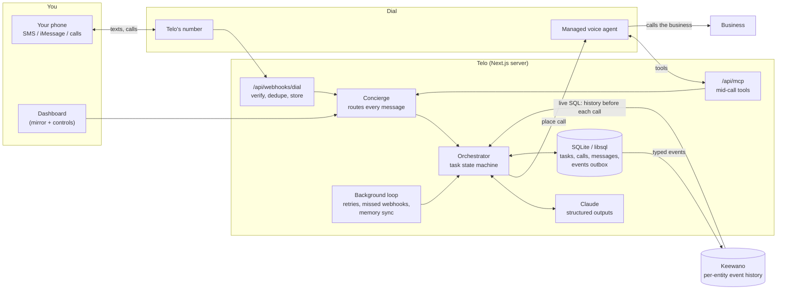

# Telo

**Delegate anything that needs a phone call.**

Text Telo, or call it: *"Cancel my gym membership."* *"My bill is wrong again, can you call them?"* *"Find a windshield shop that can do tomorrow under $400."* Telo asks only for what the call needs, makes the call with an AI voice agent, handles it on its own, and texts you when it's done. It interrupts you only for decisions that are yours to make, like a retention offer you never said how to handle. And every time it deals with a business, it remembers what happened, so the next call starts with *"On October 2 your rep promised a $20 credit under confirmation A1832..."*

Telo is not another assistant wired into your inbox and calendar. It learns what it needs just in time, for one task, and keeps a history of what businesses said and promised.

Built for SpeedHacks (SF Tech Week) on **[Dial](https://getdial.ai)** (phone numbers, AI calls, texts), **[Keewano](https://keewano.com)** (event memory) and **Claude** (reasoning).

---

## How you use it

- **Text Telo's number** (SMS or iMessage) from your phone. That's the main interface.
- **Call Telo's number.** Dial's voice agent answers as Telo and uses Telo's tools mid-call: it can start a task, answer a question Telo asked you, take your decision, or tell you the status.
- **Telo texts you back** at the moments that matter: *"Calling Equinox now."* *"They offered $18/month instead of cancelling. Accept, or keep cancelling?"* *"Done. Membership ends Nov 8, confirmation 18392."*
- **Ask anytime:** *"any update?"*, *"what did Comcast promise last time?"* Telo answers from live task state and its memory.
- **The dashboard** (http://localhost:3210) mirrors the thread as it looks on your phone, plus the work behind it: live calls, transcripts, what Telo remembered, and the query that fetched it.

## Architecture



**One task, start to finish:**

1. A text arrives (Dial webhook). The signature is verified, the event is stored under Dial's event id (so a redelivery is a no-op), and processing happens after the 200.
2. The **concierge** asks Claude to route the message: a new task, an answer to an open question, a decision, a status question, a cancel, a preference.
3. The **orchestrator** drives the task through explicit states: `new → needs_info → planning → ready → calling → reviewing → needs_approval → … → completed | failed | cancelled`. Every transition is a compare-and-swap on `(status, version)`, so racing webhooks can't double-dial.
4. **Planning** runs a live **Keewano** query for the history between you and that business, has Claude turn it into a short brief, and writes the call plan: objective, what may be disclosed, what Telo can decide alone, what needs you, what to collect.
5. The call brief is rendered with fixed guardrails: it identifies itself as an AI calling for you, never shares passwords, PINs or card numbers, never claims what it doesn't know, and defers anything outside its authority with "I'll confirm with Dylan and call back". It is then placed with Dial (`makeCall`, idempotency key = Telo's call id).
6. When Dial reports `call.transcribed`, Claude reads the transcript into structured outcomes: offers, promises, confirmation numbers, rep name, quotes, promises from earlier calls now found kept or broken, and whether a decision is needed.
7. Claude decides the next step: complete, ask you, call the next business, call back with your decision, or retry. You get one concise text.
8. Everything that happened is recorded as an event. Typed events (categories, cents, seconds; never names or transcripts) are mirrored to Keewano on four streams: you × business (the main memory), the business, the task, and you.

More detail: [docs/architecture.md](docs/architecture.md). The sponsor research behind every integration detail is in [docs/integrations/dial.md](docs/integrations/dial.md) and [docs/integrations/keewano.md](docs/integrations/keewano.md).

## Run it locally (no accounts needed)

```bash
npm install
npm run setup     # creates .env.local, generates secrets, lists what's missing
npm run dev       # http://localhost:3210
```

With no keys, everything runs on simulations, wired through the same code paths: a rule-based stand-in for Claude, a simulated phone line that plays realistic calls (with live transcripts), and local memory. Open the dashboard, expand **Demo controls**, click **Load last week's Comcast call**, then text Telo in the thread.

```bash
npm test          # state machine, webhook signatures, Keewano mapping, end-to-end flows
npm run typecheck
```

## Go live

Each service switches from simulated to live when its keys are present. The dashboard header shows which are live.

### 1. Claude

Put `ANTHROPIC_API_KEY` in `.env.local`. Default model `claude-opus-5-5` (`TELO_MODEL` to change). All model output is schema-validated structured output; prose never drives task state.

### 2. Dial: phone number, calls, texts

1. Create a Dial account at getdial.ai (email and phone verification) and copy an API key into `DIAL_API_KEY`. Set `TELO_USER_PHONE` to your mobile (E.164, like `+14155550123`).
2. Dial needs a public HTTPS URL for webhooks and mid-call tools. In a second terminal:
   ```bash
   npm run tunnel        # Cloudflare quick tunnel; writes PUBLIC_BASE_URL
   ```
3. With the app running (`npm run dev`):
   ```bash
   npm run dial:setup
   ```
   This picks Telo's number and saves `DIAL_NUMBER_ID` and `TELO_PHONE_NUMBER`. It also sets the number's inbound prompt, creates the account webhook and saves `DIAL_WEBHOOK_SECRET`, registers `/api/mcp` as a Context MCP with a bearer token, and reports account limits and texting status.
4. Restart `npm run dev`. Text the number.

**Texting caveats (read before the demo):**
- **US carriers block SMS *from* a standard number until it passes 10DLC registration** ($25, about 3–5 business days). Texts *to* Telo still arrive, and voice works both ways. Options: an iMessage number (no 10DLC, $250/month on Dial), a pre-approved number from Dial staff, or `TELO_USER_CHANNEL=voice` so Telo phones you with updates. Telo also falls back to calling you automatically when a text that needs you fails to deliver.
- **Free Dial accounts cap calls at 5 minutes and 2 at once** until the first top-up. A long hold queue will be cut off.
- Quick tunnels get a new URL each start: run `npm run dial:setup` again after restarting the tunnel.

### 3. Keewano: event memory

1. Sign up at keewano.com and create a project. In the app's chat, send `#SpeedHacks` to unlock limits.
2. Fill in `.env.local`:
   - `KEEWANO_API_KEY`: Settings → Project → API Keys, type **SDK**. This key writes events.
   - `KEEWANO_PAT`: Settings → Personal → Security, a `kwpat-…` token. This one reads, over SQL.
   - `KEEWANO_PROJECT_ID`: Settings → Details.
   - `KEEWANO_PG_USER`: your Keewano login email.
3. Run `npm run keewano:check` to register the event catalog, send a test event, and run a live SQL query.
4. **Load the demo history at least 5 minutes before presenting.** Keewano takes about 5 minutes to make new events queryable. Telo merges its own recent writes in the meantime.

What Keewano does in Telo:
- **Before every call**, Telo runs live SQL over the you × business stream and gives the call agent a brief built from what comes back: promises, offers, confirmation numbers, whether earlier promises were kept.
- **Questions nobody prepared for** ("how often has Comcast broken a promise?", "average call length?") go to Keewano. Claude writes one read-only SQL statement over Telo's event columns, Telo runs it, and Claude answers from the rows. The query is logged, so the dashboard can show it.
- **What it stores:** only typed values (task kinds, outcomes, cents, durations, confirmation codes on your own streams). Keewano has no delete API, so names, transcripts and free text never leave Telo's database.

## Configuration

Every variable is documented in [.env.example](.env.example). The important ones:

| Variable | What it does |
|---|---|
| `TELO_USER_NAME`, `TELO_USER_PHONE` | Who Telo works for; texts and calls from that number are you |
| `TELO_USER_CHANNEL` | Where proactive updates go: `sms`, `imessage`, `whatsapp`, `voice`, `web` |
| `ANTHROPIC_API_KEY`, `TELO_MODEL` | Claude |
| `DIAL_API_KEY` (+ values written by `dial:setup`) | Dial |
| `KEEWANO_API_KEY`, `KEEWANO_PAT`, `KEEWANO_PROJECT_ID`, `KEEWANO_PG_USER` | Keewano |
| `DEMO_TARGET_PHONE` | A teammate's phone that plays every business in a live demo |
| `TELO_DIRECTORY` | JSON list of businesses and numbers, overriding the demo directory |
| `DATABASE_URL` | `file:./data/telo.db` by default; a `libsql://` URL for Turso |
| `TELO_DEV_TOOLS` | Demo controls in the dashboard (default on) |

## Demo script

See [docs/demo.md](docs/demo.md). In short:
1. **Memory:** text "My bill is wrong again. Can you call them and figure it out?" Telo works out it's Comcast from your history, queries Keewano, and calls. On the call, it cites last week's $20 credit under A1832. The rep admits it was never applied and applies it. Telo records the broken promise and texts you the new confirmation.
2. **Judgment:** text "Cancel my gym membership at Equinox." Telo asks for the email, calls, and gets a retention offer. It doesn't decide for you; it texts "Accept $18/month or keep cancelling?" Reply "keep cancelling" and Telo calls back and finishes: membership ends Nov 8, confirmation 18392.
3. **Several calls:** text "Call three windshield repair shops and find one that can do tomorrow under $400." Telo calls all three, compares them, and asks to book the $330 one.
4. **Voice:** call Telo's number and ask "how's the gym thing going?"
5. **Unprepared question:** text "how many times has a business broken a promise to me?" Telo answers with a live Keewano query.

## Project layout

```
src/server/
  orchestrator.ts      task state machine: understand, plan, dial, review
  concierge.ts         routes every inbound message, call transcript and voice-tool request
  notify.ts            outbound messages, channel choice, dedupe, voice capture
  status.ts            "what's going on?" answers and the voice-line digest
  agent/               Claude calls (prompts, zod schemas), call-brief renderer, offline stand-in
  voice/               Dial client, webhook verify/normalize, simulated line, event ingest
  memory/              event recorder + outbox, Keewano client (REST in, SQL out), local stand-in
  db/                  Drizzle schema, migrations runner, seed data
  background.ts        retries, missed-webhook recovery, memory sync, voice-line refresh
src/app/api/           webhooks/dial, mcp, state, tasks, messages, dev
src/components/        dashboard (iMessage-style thread, task board, live call, task detail)
scripts/               setup, tunnel, dial:setup, keewano:check
tests/                 unit + end-to-end tests on the simulated stack
```

## Deployment notes

- Telo runs as one long-lived Node process (`npm run build && npm start`). The background loop, the simulated line and in-process task locks assume that. Any single-instance host works: Railway, Render, Fly or a VM. Point Dial at its URL with `PUBLIC_BASE_URL` and rerun `dial:setup`.
- For a serverless host (Vercel), move the background loop to a cron route and the database to Turso (`DATABASE_URL=libsql://...`). The webhook route already acknowledges first and processes in `after()`.
- Secrets live only in server env. The browser gets masked values.

## Known limitations

- Single user (one `TELO_USER_PHONE`); the data model is per user throughout.
- Dial-hosted calls don't stream transcripts, so the dashboard shows live status and the transcript lands when the call ends. The simulated line does stream.
- Approvals happen between calls ("I'll confirm and call back"), not while the business waits on the line.
- The Keewano timeline read uses one SQL query per event column and reassembles events by second. This follows Keewano's documented step-function semantics but was not verified against a live project before the event; `npm run keewano:check` confirms it on site.
- Business phone numbers come from the user, the directory or `DEMO_TARGET_PHONE`; there's no places lookup.
- A status digest is written into the voice line's prompt so callers hear status even if the agent skips a tool call. That's fine for a single-user demo; turn it off with `TELO_INBOUND_STATUS_IN_PROMPT=false`.
