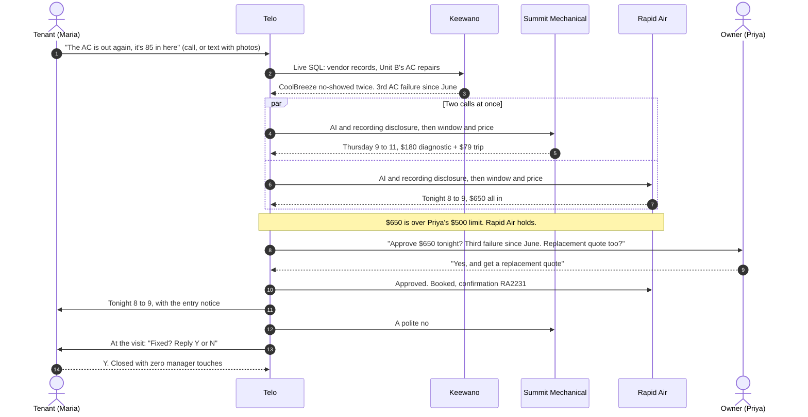
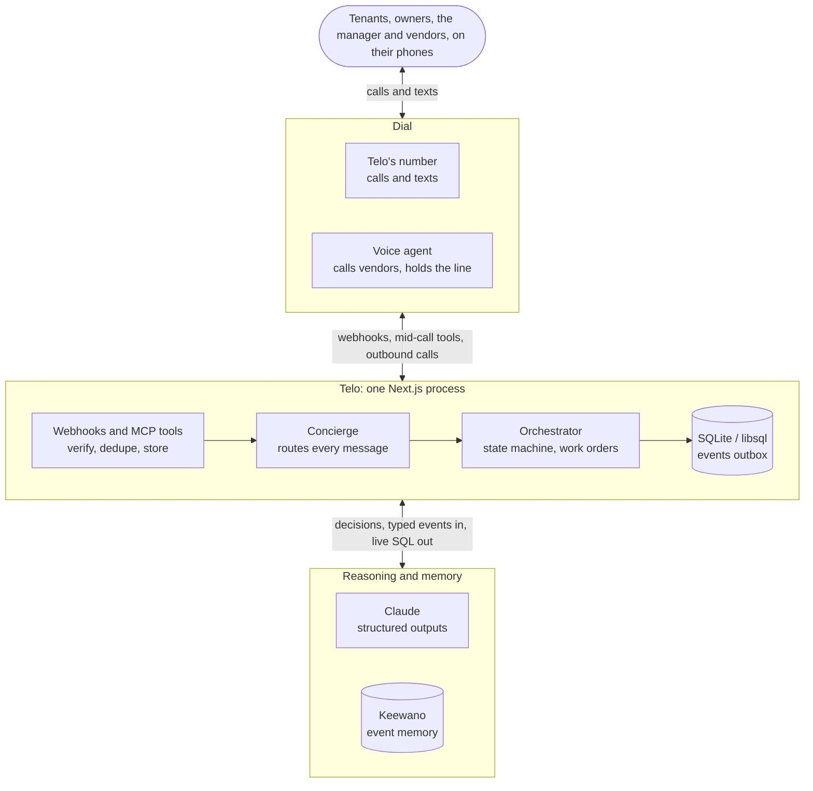

<div align="center">

# Telo

**The AI that works the phones for small rental property managers.**

Tenants call or text it. It calls two vendors at once, gets the owner's OK while a vendor holds, books the visit with the entry notice, and follows up until it's fixed.

[Quick start](#quick-start) · [How it works](#how-it-works) · [Demo script](docs/demo.md) · [Architecture notes](docs/architecture.md)

[](docs/property-management/brief.md)
[](https://getdial.ai)
[](https://keewano.com)
[](https://www.anthropic.com/claude)

</div>

---

A property manager gives Telo one phone number. A tenant calls: *"The AC is out again, it's 85 in here."* Telo triages it, checks Keewano for who to call, phones two HVAC companies at once to compare windows and prices, and texts the owner while the cheaper-sooner vendor holds the line. Then it books the tenant's window with the notice the law requires, checks "on the way?" and "fixed?" during the visit, and closes the job.

Built for firms and owner-operators with roughly 20 to 500 long-term rentals and no maintenance coordinator. A seeded portfolio (one firm, two owners, three properties, eight units, eight vendors) stands in for property-management software, so the whole thing runs without any. With no API keys it runs entirely on simulations.

## One job, start to finish



## What it does

| Calls vendors in parallel | Owner approval while the vendor holds |
| :--- | :--- |
| The top two vendors for the trade are called at the same time and compared on window, price and terms. Every call opens with "an AI assistant calling for the manager; this call is recorded." The one not booked gets a polite no. | Over an owner's approval limit, Telo texts (or calls) the owner mid-call and passes the answer back on the same call. No "I'll confirm and call you back" that loses tonight's slot. |
| **Memory that changes decisions** | **Booking, notice and follow-up** |
| Keewano holds every unit's and vendor's history. Live SQL ranks vendors by visits, no-shows, late arrivals and first-visit fixes, and two repairs on an asset within a year (or one on an old unit) make Telo ask for a replacement price too. | The tenant gets the window and the entry notice (asking consent when it's under 24 hours). Thirty minutes in: "on the way?" to the vendor, "fixed?" to the tenant. "Y" closes the job; "nobody came" records a no-show and calls the next vendor. |
| **Ask it anything** | **Safety and boundaries** |
| *"Which vendor no-shows most?"* Claude writes one read-only SELECT over Telo's event columns, Telo runs it on Keewano, and the dashboard shows the SQL. | Gas, smoke, CO or flooding gets safety instructions first and a page to the manager, with no vendor call. Legal notices, evictions, screening and payment details stay with people. Telo never dials a number nobody gave it. |

### Who talks to Telo

| | |
| :--- | :--- |
| **Tenants** | Call or text Telo's number, send photos, get the vendor's window and the entry notice, answer "fixed? Y/N". |
| **Vendors** | Get called two at a time, ranked by their record across the portfolio. |
| **Owners** | Get a text when a price is over their approval limit, while the vendor holds, and one update when the visit is booked. |
| **The manager** | Gets one text per new work order and one per booking, never a question Telo can answer itself. Can ask anything by text or call. |
| **The dashboard** | The manager's board at http://localhost:3210: headline numbers, live calls side by side with the owner's question inline, work orders by stage (new and calling, waiting on someone, booked, follow-up), and a flowchart on each work order's page. |

## Quick start

No accounts or keys needed. Requires Node.js 20.9+.

```bash
npm install
npm run setup     # creates .env.local, generates secrets, lists what's missing
npm run dev       # http://localhost:3210
```

With no keys, everything runs on simulations wired through the same code paths as the live services: a rule-based stand-in for Claude, a simulated phone line that plays the vendors with live transcripts, and local memory.

1. Open the dashboard and expand **Demo controls**.
2. Click **Load the portfolio's history**, then **Maria calls: AC is out** (or the text with photos).
3. When Rapid Air is waiting on the line, answer as Priya (**Priya (owner): yes, and get a replacement quote**, or the live card).
4. **Maria: YES to entry**, then **Check now** on the work order's page, then **Maria: Y, it's fixed**.

The full seven-minute walkthrough, with live phones, is in [docs/demo.md](docs/demo.md).

```bash
npm test          # state machine, webhook signatures, Keewano mapping, end-to-end flows
npm run typecheck
```

## How it works



**A work order, step by step** (`src/server/maintenance.ts` on top of the task engine in `src/server/orchestrator.ts`):

1. **Intake.** A tenant's text, or the transcript of their call, arrives as a Dial webhook. The signature is checked, the event is stored under Dial's event id (a redelivery is a no-op), and processing runs after the 200. A number in the portfolio opens a work order with its unit, tenancy, owner and photos.
2. **Triage.** Claude reads the report into a trade, a severity and a job code. Gas, fire or CO stops here: safety instructions, a page to the manager, no vendor call.
3. **Memory decides** (`src/server/portfolio/insights.ts`). Live Keewano SQL ranks the approved vendors for the trade, and the asset's repair history decides whether to ask for a replacement price. The work order's page shows both queries with rows and timings.
4. **Two calls at once.** The call brief is rendered with fixed guardrails (identify as an AI, never share secrets, never claim what it doesn't know) and placed with Dial. Over the owner's limit, the voice agent's `ask_customer` goes to the owner while the vendor holds.
5. **Review.** Claude reads each transcript into structured outcomes (quotes, windows, confirmation numbers, promises) and picks the next step: book, ask, call the next vendor, or schedule a callback when a vendor says "call us back in three days".
6. **Booked.** The tenant gets the window and the entry notice, the other vendor a polite no, the owner and manager one update each.
7. **Follow-up.** "On the way?" to the vendor, "fixed?" to the tenant. "Y" marks the vendor's promise kept and closes the work order with its count of manager touches.

Every step is a typed event on the Keewano streams of the unit, vendor, owner, property, tenancy, asset and firm. Mail fits in too: with Google connected (`npm run google:connect`, read-only inbox), an email from a tenant, owner or vendor lands on their work order, and a vendor emailing a new time moves the booking, the calendar event, the entry notice and the visit check.

### Engineering notes

<details>
<summary><b>A vendor is never called twice by accident</b></summary>

- **Problem:** Dial redelivers webhooks, the background loop retries failed steps, and two vendor calls can finish in the same second. The same task gets advanced from several places at once, and a double-dial rings a real business twice.
- **Approach:** every state change goes through `transitionTask`, an `UPDATE … WHERE status IN (allowed sources)` with a version bump. To dial, the task must win `ready → calling` and the call row must win `planned → queued`, and Dial's `makeCall` gets `Idempotency-Key: telo:<callId>`.
- **Why:** it works inside one SQLite file with no queue or lock service. Whoever loses a race gets `null` and backs off.
- **Tradeoff:** it assumes one long-lived Node process (per-task serialization and the background loop live in memory). A serverless host needs a cron route and Turso.

</details>

<details>
<summary><b>Memory that can't leak, in a store with no delete</b></summary>

- **Problem:** Keewano has no delete API, but tenant names, phone numbers, addresses and call transcripts have to stay deletable.
- **Approach:** only typed, low-cardinality values (trades, outcomes, cents, minutes, counts) go to Keewano, on entities named by UUID v5 under a secret namespace. Each event carries `refs` (ids only) that pick the unit, vendor, owner, tenancy, asset and firm streams. Names are resolved locally after a query returns.
- **Why:** the decisions only need counts and amounts. "CoolBreeze: 2 no-shows" doesn't need anyone's name.
- **Tradeoff:** new events take about 5 minutes to become queryable (15 to 20 on a fresh project), so Telo merges its own writes from the last hour without counting them twice. Keewano also rejects `count(...) FILTER (WHERE ...)`, so vendor ranking runs four aggregate queries with the condition in `WHERE`.

</details>

<details>
<summary><b>Getting the owner's answer while the vendor holds</b></summary>

- **Problem:** "I'll check with the owner and call you back" loses tonight's slot.
- **Approach:** Dial's voice agent calls Telo's tools mid-call over MCP (`src/server/live-call.ts`). `ask_customer` texts or calls the owner; `wait_for_customer` waits up to 15 seconds per call and tells the agent what to say meanwhile, so the line is never silent. The owner's reply by text or call, or the manager's answer in the dashboard's live card, goes back on the same call.
- **Why:** the vendor gets the answer on the same call, so the booking happens on the first call.
- **Tradeoff:** after 90 seconds the agent wraps up and Telo calls back the usual way. The prompt and tool wording were tuned in the call lab (`npm run lab:calls`, Claude playing Dial's agent).

</details>

### Stack

| Layer | What it uses |
| :--- | :--- |
| App and dashboard | Next.js 16.4 (App Router, Cache Components), React 19, Tailwind CSS 4, SWR |
| Reasoning | Claude through `@anthropic-ai/sdk`: Sonnet for the steps that drive actions, Haiku for quick routing and summaries. All output is zod-validated structured output; prose never drives task state |
| Phone number, calls, texts | Dial (`@getdial/sdk`): managed voice agent, signed webhooks, MCP tools during calls |
| Event memory | Keewano: events in over REST, live SQL out over the Postgres wire protocol (`pg`) |
| Storage | SQLite / libsql with Drizzle ORM; migrations apply on startup |
| Tests | Vitest, end-to-end on the simulated stack |

## Go live

Each service switches from simulated to live when its keys are present, and the dashboard header shows which are live.

<details>
<summary><b>1. Claude</b></summary>

Put `ANTHROPIC_API_KEY` in `.env.local` and run `npm run llm:check`. `TELO_MODEL` (default here: `claude-sonnet-5-5`) runs the steps that drive actions: understanding, planning, reading calls, deciding, Keewano SQL. `TELO_MODEL_FAST` (`claude-haiku-5-5`) runs the quick, frequent ones: sorting each text, status replies, history summaries. A Claude Max 5x/20x plan includes $100/$200 a month of API credits once you link a Console organization (claude.ai → Settings → Billing → API credits).

</details>

<details>
<summary><b>2. Dial: phone number, calls, texts</b></summary>

1. Create a Dial account at getdial.ai (email and phone verification) and copy an API key into `DIAL_API_KEY`. Set `TELO_USER_PHONE` to your mobile (E.164, like `+14155550123`).
2. Dial needs a public HTTPS URL for webhooks and mid-call tools. In a second terminal:
   ```bash
   npm run tunnel        # Cloudflare quick tunnel; writes PUBLIC_BASE_URL
   ```
3. With the app running (`npm run dev`):
   ```bash
   npm run dial:setup
   ```
   This picks Telo's number and saves `DIAL_NUMBER_ID` and `TELO_PHONE_NUMBER`. It also sets the number's inbound prompt, creates the account webhook and saves `DIAL_WEBHOOK_SECRET`, registers `/api/mcp` as a Context MCP with a bearer token, and reports account limits and texting status.
4. Restart `npm run dev`. The dashboard shows a code: text `LINK <code>` from your phone to Telo's number to link it (or set `TELO_USER_PHONE`). Then text Telo anything.

**Texting caveats (read before the demo):**
- **US carriers block SMS *from* a standard number until it passes 10DLC registration** ($25, about 3–5 business days). Texts *to* Telo still arrive, and voice works both ways. Options: an iMessage number (no 10DLC, $250/month on Dial), a pre-approved number from Dial staff, `TELO_PARTY_CALLS=1` so Telo phones tenants and owners instead, or keep updates on **Text + call** (the default) so Telo also phones you for anything that needs you. With **Text** only, undelivered texts wait in the dashboard thread, marked "Not delivered".
- **Free Dial accounts cap calls at 5 minutes and 2 at once** until the first top-up. A long hold queue will be cut off.
- Quick tunnels get a new URL each start: run `npm run dial:setup` again after restarting the tunnel.

</details>

<details>
<summary><b>3. Keewano: event memory</b></summary>

1. Sign up at keewano.com and create a project. In the app's chat, send `#SpeedHacks` to unlock limits.
2. Fill in `.env.local`:
   - `KEEWANO_API_KEY`: Settings → Project → API Keys, type **SDK**. This key writes events.
   - `KEEWANO_PAT`: Settings → Personal → Security, a `kwpat-…` token. This one reads, over SQL.
   - `KEEWANO_PROJECT_ID`: Settings → Details.
   - `KEEWANO_PG_USER`: your Keewano login email.
3. Run `npm run keewano:check` to register the event catalog, send a test event, and run a live SQL query.
4. **Load the portfolio's history at least 30 minutes before presenting:** `npm run seed:portfolio` (safe to run twice). Keewano takes about 5 minutes before new events are queryable; on a fresh project it took 15–20. Telo merges its own writes from the last hour in the meantime.

</details>

<details>
<summary><b>Configuration reference</b></summary>

Every variable is documented in [.env.example](.env.example). The important ones:

| Variable | What it does |
|---|---|
| `TELO_USER_NAME`, `TELO_USER_PHONE` | Who Telo works for; texts and calls from that number are the manager |
| `TELO_USER_CHANNEL` | Where proactive updates go: `sms`, `imessage`, `whatsapp`, `voice`, `web` |
| `TELO_CALL_UPDATES` | Starting value of the Text / Text + call toggle (default `true`: calls on). The toggle and "just text me" change it after that |
| `ANTHROPIC_API_KEY`, `TELO_MODEL` | Claude |
| `DIAL_API_KEY` (+ values written by `dial:setup`) | Dial |
| `KEEWANO_API_KEY`, `KEEWANO_PAT`, `KEEWANO_PROJECT_ID`, `KEEWANO_PG_USER` | Keewano |
| `TELO_PORTFOLIO_PHONES` | JSON map of portfolio ids to real phones for a live demo, e.g. `{"ten_alder_b":"+1…","own_shah":"+1…","ven_rapidair":"+1…","ven_summit":"+1…"}`. The seeded 555-01xx numbers reach nobody, and Telo never texts them on a real line |
| `TELO_PARTY_CALLS` | `1` to have Telo phone tenants and owners for what needs their answer (an approval while a vendor holds, an entry notice, "fixed?", safety steps) instead of texting them. Their spoken answer goes to the work order like a text. For when texts can't get through (10DLC) |
| `TELO_PORTFOLIO_EMAILS` | JSON map of portfolio ids to email addresses, e.g. `{"ven_rapidair":"luis@…"}`. Mail from a mapped address always reaches that party's work order; other portfolio mail is matched by name |
| `DEMO_TARGET_PHONE` | A teammate's phone that plays any vendor without a number of its own |
| `TELO_DIRECTORY` | JSON list of businesses and numbers, overriding the demo directory |
| `DATABASE_URL` | `file:./data/telo.db` by default; a `libsql://` URL for Turso |
| `TELO_DEV_TOOLS` | Demo controls in the dashboard (default on) |

</details>

## Project layout

```text
src/
├── app/                 the dashboard, work-order pages and the API routes
├── components/          the board, live calls, per-job flowchart, thread, demo controls
└── server/
    ├── maintenance.ts   work orders: intake, triage, approval, booking, notice, follow-up
    ├── portfolio/       the seeded firm, its history, Keewano vendor ranking and repairs
    ├── orchestrator.ts  task state machine: understand, plan, dial, review
    ├── concierge.ts     routes every message, call transcript and voice-tool request
    ├── live-call.ts     tools during calls: ask_customer, wait_for_customer, calendar
    ├── notify.ts        outbound messages, channel choice, dedupe, text + call
    ├── flow.ts          a task's events and calls → the work order's flowchart
    ├── background.ts    callbacks, retries, missed-webhook recovery, memory sync
    ├── agent/           Claude prompts and zod schemas, call briefs, offline stand-in
    ├── voice/           Dial client, webhook checks, the simulated line and scripts
    ├── memory/          event outbox, Keewano client (REST in, SQL out), local stand-in
    └── db/              Drizzle schema, migrations runner, seed data
scripts/                 setup, tunnel, dial:setup, keewano:check, llm:check,
                         seed:portfolio, lab and lab:calls (Claude-driven test labs)
tests/                   unit and end-to-end tests on the simulated stack
docs/
├── architecture.md      developer notes: states, events, Keewano mapping, authority
├── demo.md              the demo script
├── integrations/        what we verified about the Dial and Keewano APIs
└── property-management/ the product brief and market research
```

## Deployment

- Telo runs as one long-lived Node process (`npm run build && npm start`). The background loop, the simulated line and in-process task locks assume that. Any single-instance host works: Railway, Render, Fly or a VM. Point Dial at its URL with `PUBLIC_BASE_URL` and rerun `dial:setup`.
- For a serverless host (Vercel), move the background loop to a cron route and the database to Turso (`DATABASE_URL=libsql://...`). The webhook route already acknowledges first and processes in `after()`.
- Secrets live only in server env. The browser gets masked values.

## Known limitations

- One firm and one manager (`TELO_USER_PHONE`). The portfolio is seeded in code (`src/server/portfolio/data.ts`); connecting Buildium or AppFolio comes later.
- Work orders cover maintenance. Rent, turnovers, bids, leasing and renewals are researched ([docs/property-management/](docs/property-management/)) but not built.
- A vendor is booked on the call. If neither can book, Telo gives the manager the comparison and calls back the one they pick.
- Owner questions that aren't approvals ("how's my property?") are forwarded to the manager.
- Dial-hosted calls don't stream transcripts, so the dashboard shows live status and the transcript lands when the call ends. The simulated line does stream.
- Help while the vendor waits is tested in the call lab (Claude playing Dial's agent) and on the simulated line, not yet on a live Dial call. If Dial's agent can't talk between tool calls, the waits are silent; the fallback is the old "I'll confirm and call back".
- The Keewano timeline read uses one SQL query per event column and reassembles events by second. The work-order decisions use targeted aggregate queries instead, checked against the live project on demo day.
- Phone numbers come from the manager, the portfolio, the directory or `DEMO_TARGET_PHONE`; there's no places lookup.
- A status digest is written into the voice line's prompt so callers hear status even if the agent skips a tool call. That's fine for a single-manager demo; turn it off with `TELO_INBOUND_STATUS_IN_PROMPT=false`.

## License

[MIT](LICENSE)
